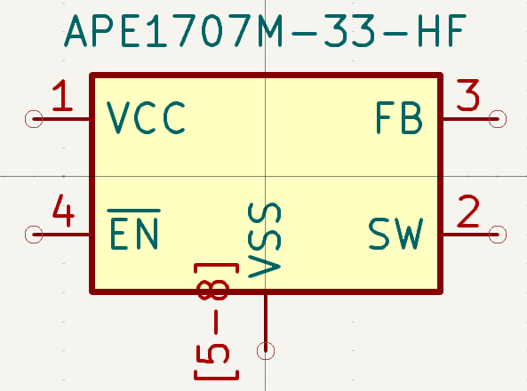
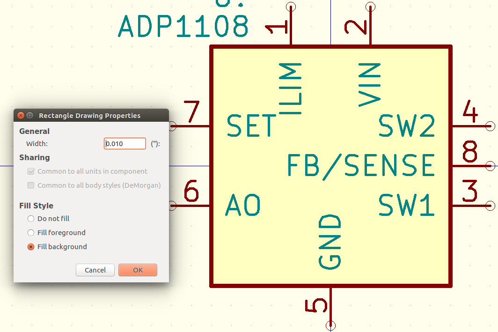
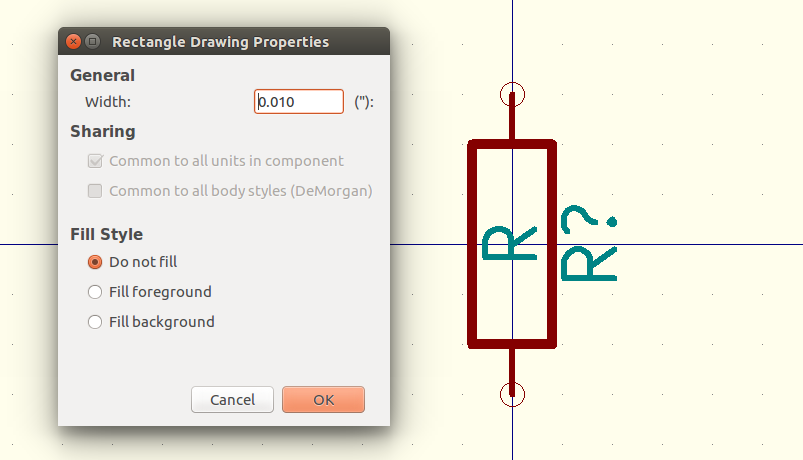
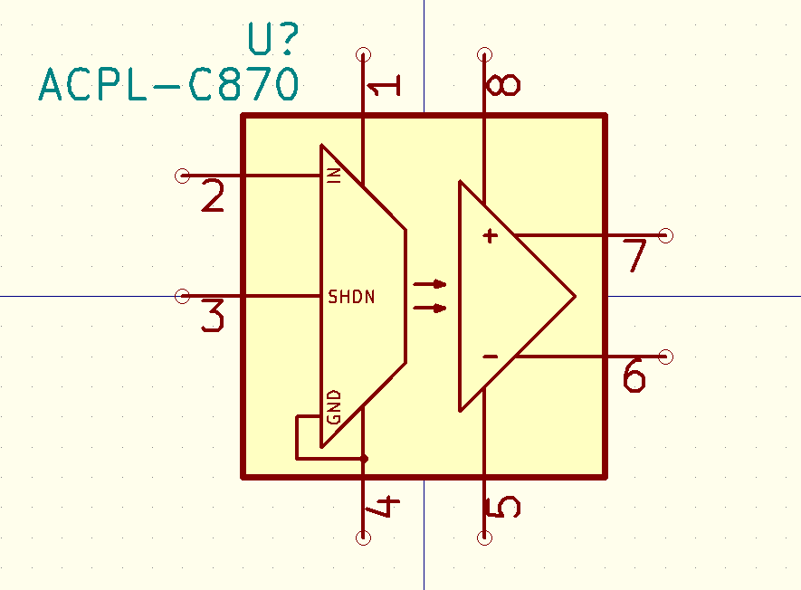
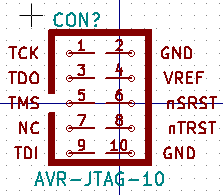
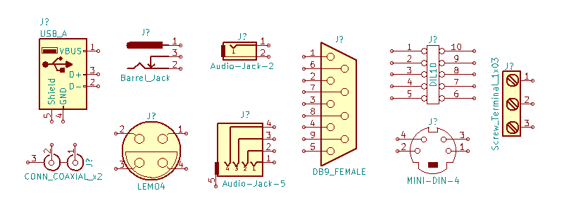
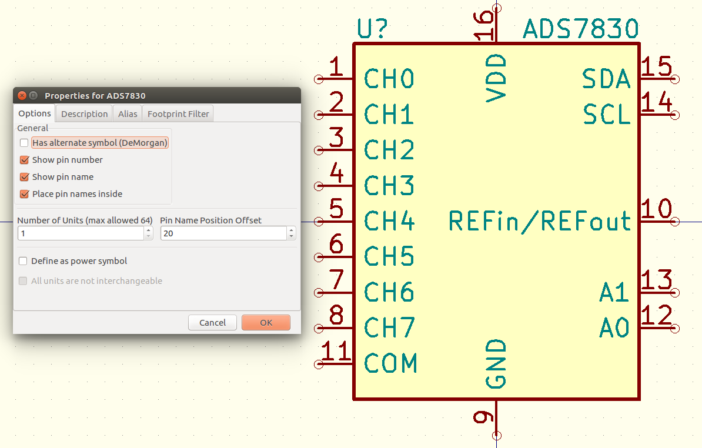
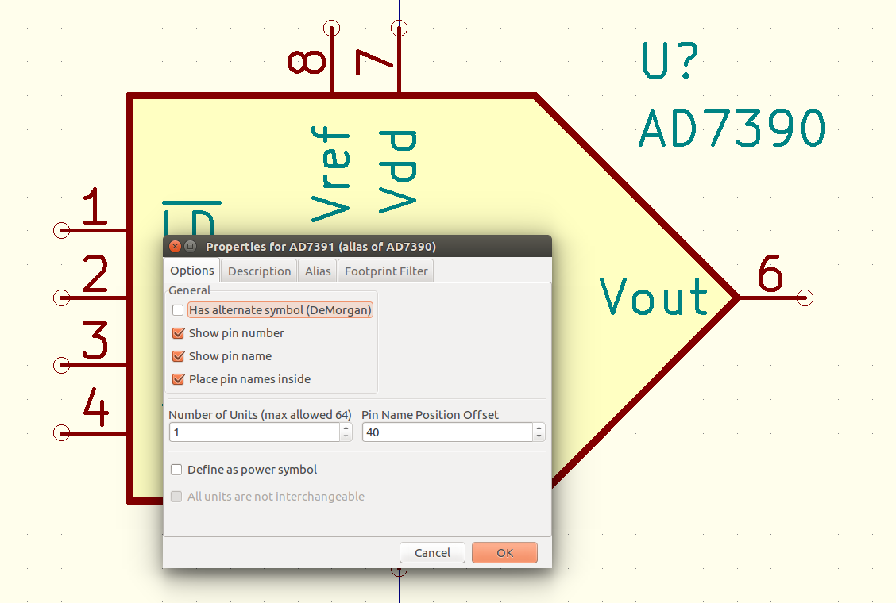
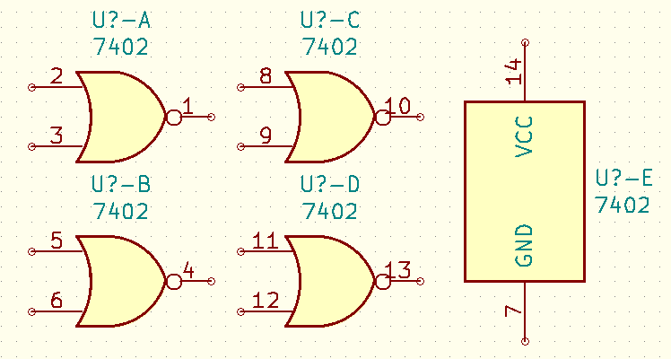

# KLC: symbol graphics and units

Selected upstream text, reformatted for offline reading. Attribution: **KiCad Library Conventions contributors**, **CC BY 3.0**; [license and provenance](NOTICE.md). These are upstream library rules, not project overrides. Read our separate [applicability profile](../klc-profile.md) first.

- [S3.1](#s31)
- [S3.2](#s32)
- [S3.3](#s33)
- [S3.4](#s34)
- [S3.5](#s35)
- [S3.6](#s36)
- [S3.8](#s38)

## S3.1

**Origin is centered on the middle of the symbol**

[Pinned upstream source](https://gitlab.com/kicad/libraries/klc/-/blob/6e8cbad9556359879d2b91f904d6df82517d97d1/content/symbol/S3/S3.1.adoc)

For symmetrical symbols, the symbol must be centered around the origin (`0`, `0`) in the symbol editor.

*Exception:*

For non-symmetrical symbols, or symbols where this requirement would move pins off the `100mil` grid, then the symbol should be placed _as close to the origin as possible_ while observing the pin grid alignment requirements.

## S3.2

**Text fields should use a common text size of 50mils**

[Pinned upstream source](https://gitlab.com/kicad/libraries/klc/-/blob/6e8cbad9556359879d2b91f904d6df82517d97d1/content/symbol/S3/S3.2.adoc)

1. All text fields (pin name, pin number, value, reference, footprint, datasheet) should use a text size of `50mil` (`1.27mm`).
2. Pin names and pin numbers can use a text size as small as 20mil if the symbol is small or has special geometry.

## S3.3

**Symbol outline and fill requirements**

[Pinned upstream source](https://gitlab.com/kicad/libraries/klc/-/blob/6e8cbad9556359879d2b91f904d6df82517d97d1/content/symbol/S3/S3.3.adoc)

1. Symbol body must have a line width of `10mil` (`0.254mm`)
2. Black-box symbols (e.g. ICs with hidden functionality) should be filled with background color
3. Simple components (e.g. discrete components or those with a _distinctive shape_) should not be filled with background color

*Fill background*

*Do not fill*

## S3.4

**Symbols with complex functionality may incorporate simple functional diagrams**

[Pinned upstream source](https://gitlab.com/kicad/libraries/klc/-/blob/6e8cbad9556359879d2b91f904d6df82517d97d1/content/symbol/S3/S3.4.adoc)

For _black box_ symbols with complex functionality (e.g. special function ICs), a simplified diagram of the symbol functionality may be drawn on the symbol. This may be used to provide functional clarity in a schematic.

1. Functional drawing must remain _simple_
2. Do not add functional drawings for multi-function components (e.g. microcontrollers)

## S3.5

**Pin connection points must be placed outside of the symbol**

[Pinned upstream source](https://gitlab.com/kicad/libraries/klc/-/blob/6e8cbad9556359879d2b91f904d6df82517d97d1/content/symbol/S3/S3.5.adoc)

Connection points for symbol pins must be placed outside the symbol body and must not require a connecting wire to cross the symbol.

*Example of incorrect symbol:*

*Example of correct symbols:*

## S3.6

**Pin name position offset**

[Pinned upstream source](https://gitlab.com/kicad/libraries/klc/-/blob/6e8cbad9556359879d2b91f904d6df82517d97d1/content/symbol/S3/S3.6.adoc)

1. Pin name position offset must not exceed `50mil` (`1.27mm`)
2. Pin name position offset should not be set less than `20mil` (`0.508mm`)
3. Preferred value is `20mil`
4. Larger offset allowed to accomodate particular symbol geometry

*Examples:*

## S3.8

**Multi unit symbols**

[Pinned upstream source](https://gitlab.com/kicad/libraries/klc/-/blob/6e8cbad9556359879d2b91f904d6df82517d97d1/content/symbol/S3/S3.8.adoc)

1. For symbols with multiple units that are drawn separately, where the units share common power pins, a separate unit should be drawn which contains these power pins.

__This approach should not be taken for single-unit symbols. Power pins in this case must be drawn on the same symbol as the logic pins.__
