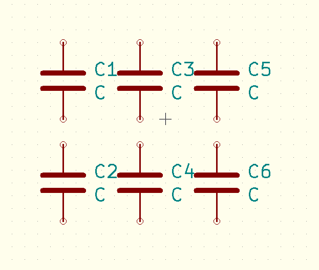
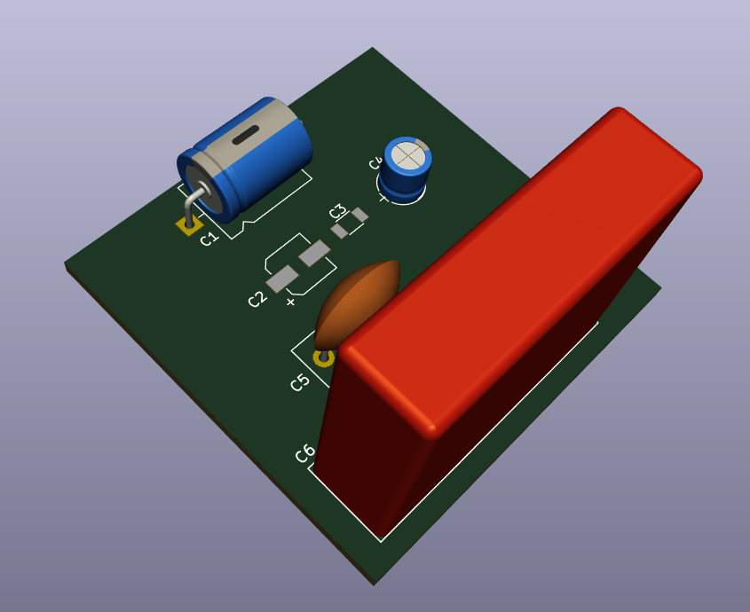
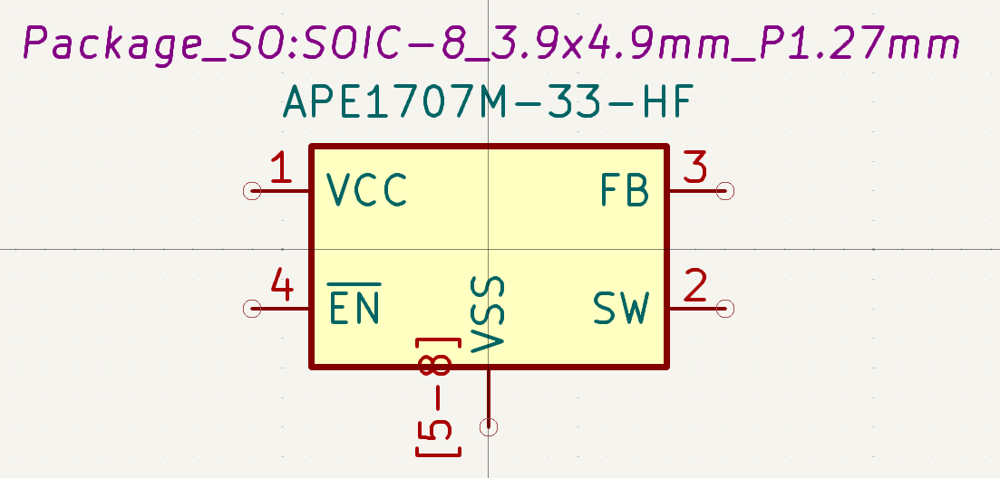
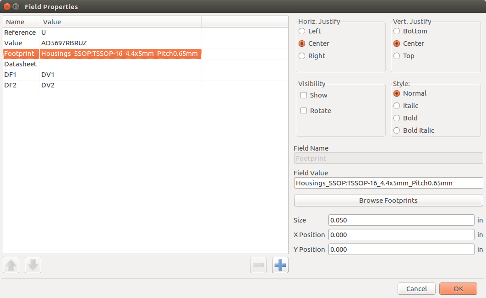
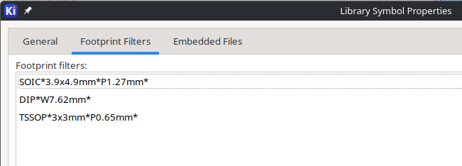
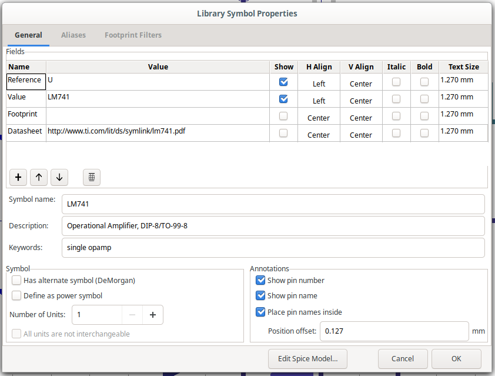
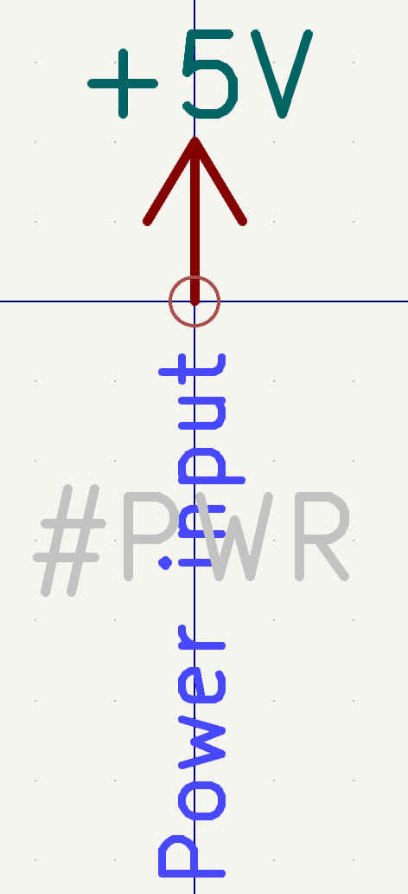

# KLC: symbol reuse, fields, footprints and power symbols

Selected upstream text, reformatted for offline reading. Attribution: **KiCad Library Conventions contributors**, **CC BY 3.0**; [license and provenance](NOTICE.md). These are upstream library rules, not project overrides. Read our separate [applicability profile](../klc-profile.md) first.

- [G2.1](#g21)
- [S5.1](#s51)
- [S5.2](#s52)
- [S6.2](#s62)
- [S7.1](#s71)

## G2.1

**Definition of terms: Generic and fully specified symbols**

[Pinned upstream source](https://gitlab.com/kicad/libraries/klc/-/blob/6e8cbad9556359879d2b91f904d6df82517d97d1/content/general/G2/G2.1.adoc)

KiCad has two workflows regarding what a symbol represents and when it is assigned a footprint. It can be done in the library in which case the symbol represents an exact part or using the "Assign Footprints" tool at the end of the design process.

**Generic symbols**

Generic symbols can be used with multiple footprints. They _do not_ have a default footprint assigned. Generic symbols allow flexibility in the design workflow. For this workflow the symbol placed into the schematic is typically selected to fit the intended function instead of fitting a particular part. The footprint assignment happens later when the exact part number is selected. Using generic symbols allows a small number of library symbol elements to represent a _very large number_ of possible component combinations.

An example of the use of generic symbols are the **Resistor** and **Capacitor** symbols available in the KiCad library. These symbols do not have an assigned default footprint, as there are _many_ possible compatible footprints.

**Fully specified symbols**

Fully specified symbols define a matching footprint, and are named based on the `MPN` (manufacturer part number). Such symbols do not depend on the user to select the correct footprint later but can have alternative footprints defined using footprint filters such that the user can select an alternate footprint.

_A fully specified symbol together with a footprint specialized to one component are called an atomic part. A library of only such parts is called an atomic library. Confusingly, some users refer to a fully specified symbol as an atomic symbol._

**Where to use which type**

The official library requires fully specified symbols except for a small number of libraries that contain only generic symbols. These generic libraries are:

- `Device`
- All `Connector` libraries
- The logic family libraries like `74xx`, `4xxx`, ...

## S5.1

**Symbols with a default footprint link to a valid footprint file**

[Pinned upstream source](https://gitlab.com/kicad/libraries/klc/-/blob/6e8cbad9556359879d2b91f904d6df82517d97d1/content/symbol/S5/S5.1.adoc)

1. For _fully specified_ symbols (those with an associated default footprint), the *Footprint* field must be filled with a valid entry of the format `<footprint_library>:<footprint_name>`.
2. For _generic_ symbols (those which map to multiple possible footprints), the *Footprint* field must be left blank

## S5.2

**Footprint filters must match all appropriate footprints. They should be designed to result in no false suggestions.**

[Pinned upstream source](https://gitlab.com/kicad/libraries/klc/-/blob/6e8cbad9556359879d2b91f904d6df82517d97d1/content/symbol/S5/S5.2.adoc)

Footprint filters are used to help match appropriate footprints to a given symbol. This is important even for _fully specified_ symbols (symbols with only one matching footprint), as there still may be multiple compatible footprints with different variants or options (e.g. `_HandSoldering`, `_Heatsink`, `_ThermalVias`).

Footprint filters use wildcard pattern matching, and allow the following wildcards:

- `*` - Match zero or many characters
- `?` - Match zero or one characters

The library name can be used as a filter criterium. The delimiter between library and footprint filtering is `:`

Filter conventions:

1. Filters must end with a `*` wildcard to allow matching of modified footprint suffixes
2. Filters must match the dimensional information (where required) to be as specific as necessary:
   - `DIP*W7.62mm*` to match `DIP-22_W7.62mm` but not `DIP-22_W9.3mm`
   - The size of the mask cutout is not included in the filter.
   - Exposed/thermal pad sizes are included in the filter if that is necessary to distinguish between otherwise-ambiguous footprints.
3. Filters must not contain the pin count if the pin-count in the symbol matches the pin count in the footprint. In those cases the footprint is matched by KiCad's pin count filter. If not all pins are present in the symbol (e.g. NC-pins) the pin-count has to be part of the footprint filter (see [requirements for NC pins](pins.md#s45)). Then e.g. `SOT?23?5` might be used instead of simply `SOT?23*` to match `SOT-23-5`.
   - Special pin specifiers are always included. Meaning the specifier for Exposed pads `EP`, Mounting pad `MP` and Shield `SH` including their count must be included if the symbol uses these pins. (Filter for QFN-16-1EP_3x3mm_P0.5mm_EP1.8x1.8mm would be `QFN*1EP*3x3mm*P0.5mm*`)
4. By default, the footprint search does _not_ include the name of the footprint library. To force the library name to be included, add the `:` (colon) character to the filter. Text appearing before the `:` will match the library name. Text appearing after the `:` will match the footprint name.
   - `Connector*:*Pitch?1.25mm*` will match any footprint with '1.25mm' pitch, only in libraries that begin with the text 'Connector'
5. Escape the characters `-` and `_` by replacing them with `?`.
   - `SOT?23` will match `SOT-23` and `SOT_23`. This gives more flexibility in matching footprint naming.

Footprint filters can be set in the *Footprint Filter* tab in the *Symbol Properties* window.

## S6.2

**Symbol fields and metadata filled out as required**

[Pinned upstream source](https://gitlab.com/kicad/libraries/klc/-/blob/6e8cbad9556359879d2b91f904d6df82517d97d1/content/symbol/S6/S6.2.adoc)

1. *Reference* field is selected appropriately for the symbol and is _visible_
2. *Value* field contains the name of the symbol and is _visible_
3. *Footprint* field contains footprint link for fully specified symbols and must be _invisible_
   1. The footprint field must be empty for generic symbols
4. *Datasheet* entry is filled out, and is _invisible_
   1. For generic symbols, the datasheet field should be a tilde (`~`)
5. KLC Exception properties are allowed start with "KLC_" and are allowed, but they should only be added after a discussion with a librarian.
6. The symbol contains no other custom fields

Additional documentation is provided via two other fields:

6. **Description** field contains comma-separated device information
   1. For symbols with a default footprint, the simplified footprint name should be appended to the description e.g. `SOIC-8`
   1. Part name should not be duplicated in the description field
7. **Keywords** field contains space-separated keyword values. These values are used to assist in part searching and should be selected to assist end-users in finding suitable parts
   1. Keywords should contain typical aliases for words, **Example:** Description contains `Operational amplifier` => keywords should contain `opamp`.
   1. Keywords should not include filler words. *Example* `positive negative` instead of `positive and negative`
   1. Any single word which already appears in the description field, should not be included in the keywords field. *Example:* Description = `50mA Low-Dropout voltage regulator, QFN-16` => Keywords could include `LDO` but not `regulator` or `QFN`
   1. In case phrases (multiple words which belong together) are used in the keywords, the must not be separated by spaces, but by a dash. *Example:* `voltage-regulator` instead of `voltage regulator`
   1. Words which are prefixes of other words from either the Keywords or Description field should not appear in the keywords. *Example:* Description = `FPGA with Brown-Out detection, QFN-16` => Keywords could include `brownout` but not `brown`

## S7.1

**Power symbols**

[Pinned upstream source](https://gitlab.com/kicad/libraries/klc/-/blob/6e8cbad9556359879d2b91f904d6df82517d97d1/content/symbol/S7/S7.1.adoc)

Power symbols are special symbols in KiCad, used to designate global nets for power connections.

1. Reference Designator must be set to `#PWR`
2. Power symbols must contain exactly one pin, which is set to *visible*. Note:
   Before KiCad 8, power symbol pins needed to be invisible, but in KiCad 8 and
   later they should be visible
3. Electrical pin type must be set to `Power Input`
4. Pin name must be set to `~`
5. Value field must match the symbol name
6. Checkbox `Define as power symbol` must be checked

The example image below demonstrates the requirements as listed above:

