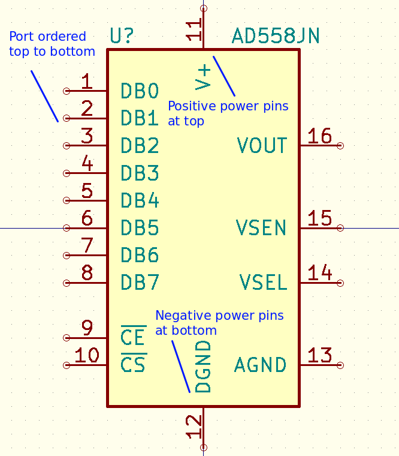
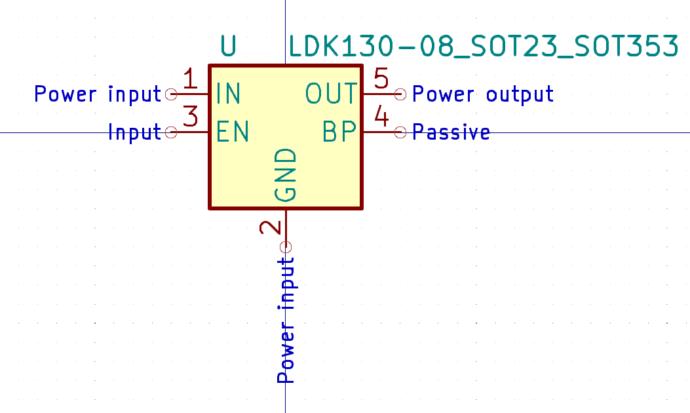
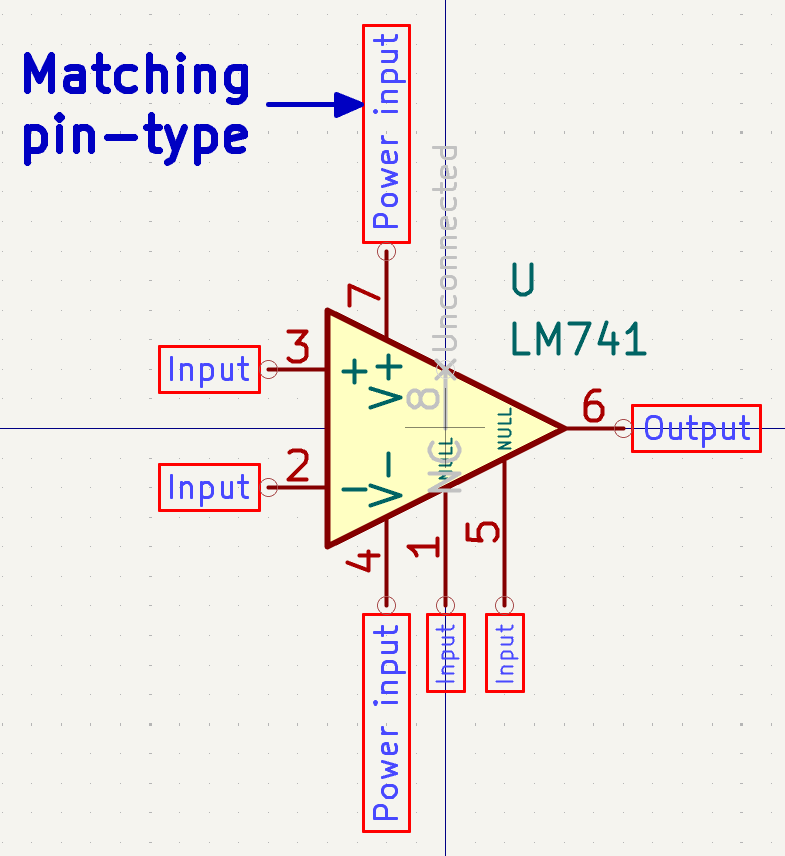
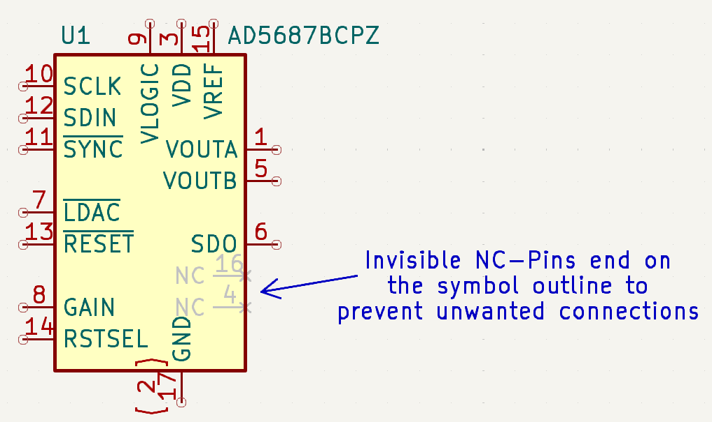

# KLC: pins, grouping and electrical types

Selected upstream text, reformatted for offline reading. Attribution: **KiCad Library Conventions contributors**, **CC BY 3.0**; [license and provenance](NOTICE.md). These are upstream library rules, not project overrides. Read our separate [applicability profile](../klc-profile.md) first.

- [S4.1](#s41)
- [S4.2](#s42)
- [S4.3](#s43)
- [S4.4](#s44)
- [S4.5](#s45)
- [S4.6](#s46)
- [S4.7](#s47)

## S4.1

**General pin requirements**

[Pinned upstream source](https://gitlab.com/kicad/libraries/klc/-/blob/6e8cbad9556359879d2b91f904d6df82517d97d1/content/symbol/S4/S4.1.adoc)

1. Using a `100mil` (`2.54mm`) grid, pin origin must lie on a grid node (IEC-60617)
2. Pins should have a length of at least `100mil` (`2.54mm`)
   - Pin length can be increased in steps of `50mil` (`1.27mm`)
   - The number of characters in the pin number determine a pin's length. When there are two characters in the pin number then `100mil` (`2.54mm`) long pins should be used, when three characters then `150mil` (`3.81mm`) long pins should be used, etc.
   - Pin length must not exceed `300mil` (`7.62mm`)
   - Shorter pins are allowed on simple symbols for discrete devices such as resistors, capacitors, etc.
   - All pins on a symbol must have the same length
3. Pin numbers must be unique (no two pins may have the same number)
4. Pin names should match the pin names as specified in datasheet
5. Pins that have multiple functions (e.g. muxable microcontroller pins) should make use of the alternate-pin-function feature
   - Pins can use the slash-notation like `IO20/RXD` for frequently used (UART, JTAG, USB, ...) functions. There should not be more than two functions to keep it readable.
   - Alternate functions that are critical to the operation of the part should be in the primary pin name. This includes so-called 'strapping pins' - pins used to configure the chip during reset. Example: `LED1/SPEED` on a ethernet PHY where `SPEED` is the strapping function and `LED1` the main function.

## S4.2

**Pins should be grouped by function**

[Pinned upstream source](https://gitlab.com/kicad/libraries/klc/-/blob/6e8cbad9556359879d2b91f904d6df82517d97d1/content/symbol/S4/S4.2.adoc)

Where possible, pins should be grouped by similar function, rather than by their physical location on the associated footprint. This provides cleaner schematic routing and symbols are easier to understand in the schematic.

1. Pins with *similar functions* should be grouped together:
   - `SPI_MISO`, `SPI_MOSI`, `SPI_CS`, `SPI_CLK`
   - `UART_TX`, `UART_RX`
2. *Ports* should be ordered from top to bottom
3. *Positive power* pins should be placed at the _top_ of a symbol
   - `Vcc`, `Vdd`, `Vin`, `V+`, etc.
4. *Negative power* and *ground* pins should be placed at the _bottom_ of a symbol
   - `GND`, `Vss`, `V-`, etc.
   - **Exception** Devices intended for power conversion that have both a power in- and output should have the power input pins on the left and the power output pins on the right.
5. *Input/Control/Logic* pins should be placed on the _left_ of a symbol
   - `Enable`, `Sleep`
   - `Iset`
6. *Output/Controlled/Driver* pins should be placed on the _right_ of a symbol
   - `Alarm`
   - `ChargeFinished`
   - `Q`, `!Q`
7. *Bus connections* like SPI/I²C/.. should be arranged according to library standards (Examples can be found in the wiki, https://gitlab.com/groups/kicad/libraries/-/wikis/Symbole-Bus-Pin-Order)

## S4.3

**Rules for pin stacking**

[Pinned upstream source](https://gitlab.com/kicad/libraries/klc/-/blob/6e8cbad9556359879d2b91f904d6df82517d97d1/content/symbol/S4/S4.3.adoc)

Many symbols have corresponding footprints where multiple physical pins are connected to a single logical net. It is desirable that in such cases the user only has to connect a single pin in the schematic, and it will automatically route to all the physical pins on the PCB.
(This is not only done to reduce clutter in the schematic drawing. The main reason is to move some responsibility for correct connections from the circuit designer over to the library.)

Since version 10, KiCad supports native pin stacks. The earlier workaround which placed pins in the same location must not be used anymore.

1. Pinstacks must *not* be of type `No Connect` (these pins should never be connected together)
2. Power supply pins should be stacked, this is especially true for `GND` pins

## S4.4

**Pin electrical type**

[Pinned upstream source](https://gitlab.com/kicad/libraries/klc/-/blob/6e8cbad9556359879d2b91f904d6df82517d97d1/content/symbol/S4/S4.4.adoc)

Pin `Electrical type` should be set to match the appropriate pin function

1. Power and ground pins should be set to either `Power Input` or `Power Output`
2. Logic pins should be set according to datasheet requirements
3. Pins with programmable functionality (e.g. MCU I/O ports) should be set to `Bidirectional`
4. Pins must not be 'double inverted' by assigning the inverting graphical symbol and also having a bar above the name of the pin

## S4.5

**Pins not connected on the footprint may be omitted from the symbol**

[Pinned upstream source](https://gitlab.com/kicad/libraries/klc/-/blob/6e8cbad9556359879d2b91f904d6df82517d97d1/content/symbol/S4/S4.5.adoc)

Often a component has pins that are not physically connected.
Even these pins should be included in the symbol. Refer to the [requirements for hidden pins](pins.md#s46).

However in some cases unconnected pins may be omitted from the schematic symbol.

1. Pins may only be omitted if they are never to be connected _under any circumstances_
2. Unconnected pins may only be omitted if including them would make the symbol unnecessarily large.
3. If pins are designated `NC` but the datasheet specifies that these must be pulled to ground or otherwise connected to a specific net, then these **must** be shown on the schematic symbol
4. The footprint filter must include the pad count of the footprint if the symbol has omitted pins (see also [requirements for footprint filters](library-fields.md#s52))
   - `BGA?144`
   - `QFN?20`

## S4.6

**Hidden pins**

[Pinned upstream source](https://gitlab.com/kicad/libraries/klc/-/blob/6e8cbad9556359879d2b91f904d6df82517d97d1/content/symbol/S4/S4.6.adoc)

Hidden symbol pins are generally not allowed for schematic symbols. Any connection point must be visible, otherwise unexpected net connections can occur.

**Exceptions**

1. Power input pins must not be invisible unless used in power symbols (hidden power input pins are global labels).
2. Pins that are not intended to be connected must be set to invisible. In this case the electrical type must be `Not Connected`. The end of the pin should lie within or on the symbols outline to prevent unwanted connections to the invisible pin (see screenshot below).
   - Pins specified as not connected may be shown if they are expected to be connected in a significant number of usecases. (Example: The datasheet suggests them to be connected to ground or some other potential for better EMC behaviour.)

## S4.7

**Active low pins should be designated using a bar above the symbol name**

[Pinned upstream source](https://gitlab.com/kicad/libraries/klc/-/blob/6e8cbad9556359879d2b91f904d6df82517d97d1/content/symbol/S4/S4.7.adoc)

Rather than selecting the _active low_ graphical pin style, active low pins should be designated using a bar above the pin name.

This provides a cleaner look for the schematic.

To place a line above the pin text, add curly brackets {} around the name, and prefix with the (`~`) character. In case of a pin name where only a part of it is
active low, and hence, not all of it needs a bar above, e.g. `\~{SPD_LED}/GPIO2`.

If the pin name given by the manufacturer includes an active low prefix or suffix, it should be removed when adding the bar above it
to avoid negating it twice. For example for `nRESET`, use `~{RESET}`.
